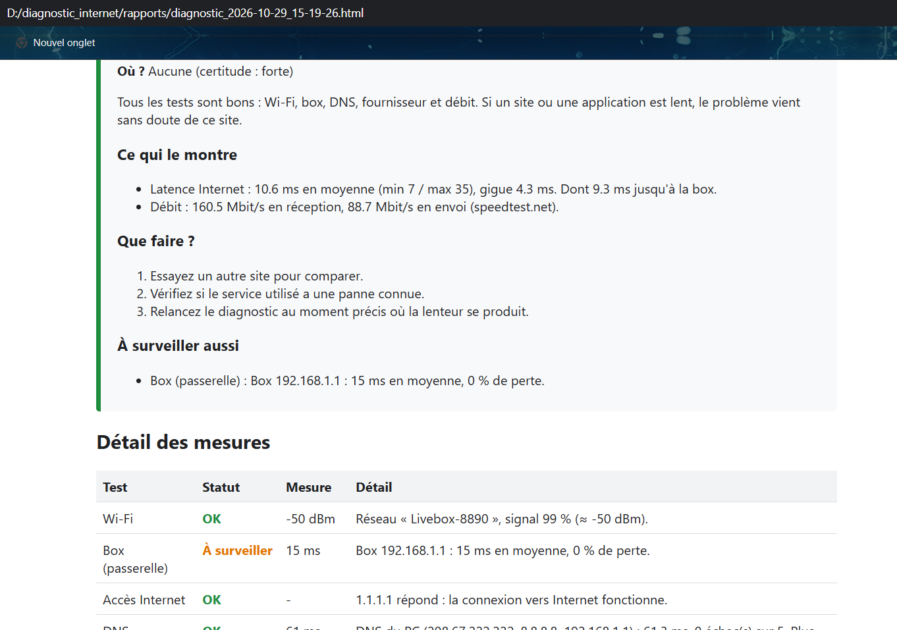
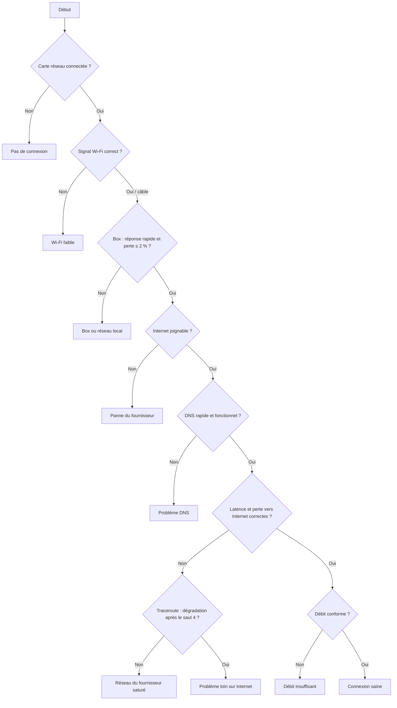

# Pourquoi mon Internet est lent ?

Application Python de **diagnostic de connexion Internet** pour Windows. Elle teste la connexion étape par étape, du PC jusqu'à Internet, puis explique **en langage clair** où se situe le problème (Wi-Fi, box, DNS, fournisseur d'accès…) et quoi faire.

> Projet PPE — Bachelor 3, blocs de compétences réseaux et développement.



## Fonctionnalités

- **8 tests réseau**, du plus proche au plus lointain : connexion et Wi-Fi, box, accès Internet, DNS, latence, perte de paquets, traceroute et débit.
- **Arbre de décision** qui désigne la cause principale parmi 9 diagnostics possibles, avec les preuves chiffrées et un niveau de certitude.
- **Explications sans jargon** et conseils concrets pour chaque cause.
- **Interface graphique** (tkinter) et **version console** (rich).
- **Rapport HTML** daté, transmissible à son fournisseur d'accès.
- **62 tests unitaires** (pytest) et une **validation par 7 pannes simulées**.

## Prérequis

- Windows 10 ou 11
- Python 3.11 ou plus récent
- Une connexion réseau (Wi-Fi ou câble)

## Installation

```powershell
git clone https://github.com/Adriano74f/diagnostic_internet.git
cd diagnostic_internet
python -m venv .venv
.venv\Scripts\activate
pip install -r requirements.txt
```

## Utilisation

**Interface graphique** (recommandée) : double-cliquez sur `lancer.bat`, ou :

```powershell
python application.py
```

Indiquez éventuellement le débit de votre abonnement, puis cliquez sur **Lancer le diagnostic** (environ 2 minutes).

**Version console :**

```powershell
python main.py
```

Dans les deux cas, un rapport HTML est enregistré dans le dossier `rapports/`.

> Sous Windows 11, la lecture du signal Wi-Fi peut nécessiter d'activer la localisation : *Paramètres → Confidentialité et sécurité → Localisation*.

## Fonctionnement

### Les tests

| # | Test | Mesure | Outil |
|---|---|---|---|
| 1 | Connexion / Wi-Fi | Type de connexion, signal (RSSI en dBm), canal, débit de liaison | `Get-NetAdapter`, `netsh wlan` |
| 2 | Box (passerelle) | Latence et perte vers la box | `Get-NetRoute`, `ping` |
| 3 | Accès Internet | Réponse de serveurs publics (1.1.1.1, 8.8.8.8) | `ping` |
| 4 | DNS | Temps de résolution : DNS du PC vs DNS publics | `dnspython` |
| 5 | Latence | Moyenne, min/max, gigue | `ping` (20 paquets) |
| 6 | Perte de paquets | Perte vers la box et vers Internet | `ping` |
| 7 | Traceroute | Saut où la latence augmente durablement | `tracert` |
| 8 | Débit | Descendant / montant, comparé à l'abonnement | `speedtest-cli`, repli Cloudflare |

### L'arbre de décision



La première anomalie rencontrée, en partant du PC, est la cause principale. Les problèmes qui en découlent ne sont pas listés en plus.

### Seuils

| Mesure | OK | À surveiller | Problème |
|---|---|---|---|
| Signal Wi-Fi | ≥ -60 dBm | -60 à -70 dBm | < -70 dBm |
| Latence vers la box | ≤ 10 ms | ≤ 30 ms | > 30 ms |
| Latence vers Internet | ≤ 50 ms | ≤ 100 ms | > 100 ms |
| Gigue | ≤ 10 ms | ≤ 30 ms | > 30 ms |
| Perte de paquets | 0 % | ≤ 2 % | > 2 % |
| Résolution DNS (médiane) | ≤ 100 ms | ≤ 300 ms | > 300 ms ou échec |
| Débit (abonnement connu) | ≥ 50 % | ≥ 20 % | < 20 % |
| Débit (abonnement inconnu) | ≥ 20 Mbit/s | ≥ 5 Mbit/s | < 5 Mbit/s |

## Structure du projet

```
diagnostic-internet/
├── application.py        # interface graphique (tkinter)
├── main.py               # version console (rich)
├── execution.py          # enchaînement des 8 tests
├── arbre_decision.py     # logique de diagnostic
├── explications.py       # textes en langage clair
├── rapport.py            # rapport HTML
├── modele.py             # ResultatTest, Diagnostic
├── seuils.py             # seuils et classement
├── outils.py             # commandes Windows, décodage, ping
├── tests_reseau/         # un module par test
├── tests/                # tests unitaires + sorties de référence
└── docs/                 # validation, manuel utilisateur, captures
```

## Tests et validation

```powershell
pytest -v
pytest --cov=. --cov-report=term-missing
```

- **Tests unitaires :** seuils (valeurs limites), analyse des sorties de `ping` et `tracert` (français et anglais, sorties réelles), toutes les branches de l'arbre de décision et le rapport HTML.
- **Pannes simulées :** 7 pannes reproduites avec les paramètres de Windows et l'outil Clumsy, toutes correctement diagnostiquées. Voir [docs/validation.md](docs/validation.md).

## Limites connues

- Windows uniquement (commandes `netsh`, `tracert`, PowerShell).
- IPv4 uniquement.
- La localisation des sauts du traceroute (box / fournisseur / Internet) est une approximation.
- La mesure de débit de secours (Cloudflare) utilise une seule connexion et peut sous-estimer une fibre très rapide.
- Le DNS de la box met en cache les sites courants, ce qui peut le faire paraître plus rapide qu'il ne l'est pour un site jamais visité.

## Documentation

- [Manuel utilisateur](docs/manuel_utilisateur.md)
- [Validation par pannes simulées](docs/validation.md)
